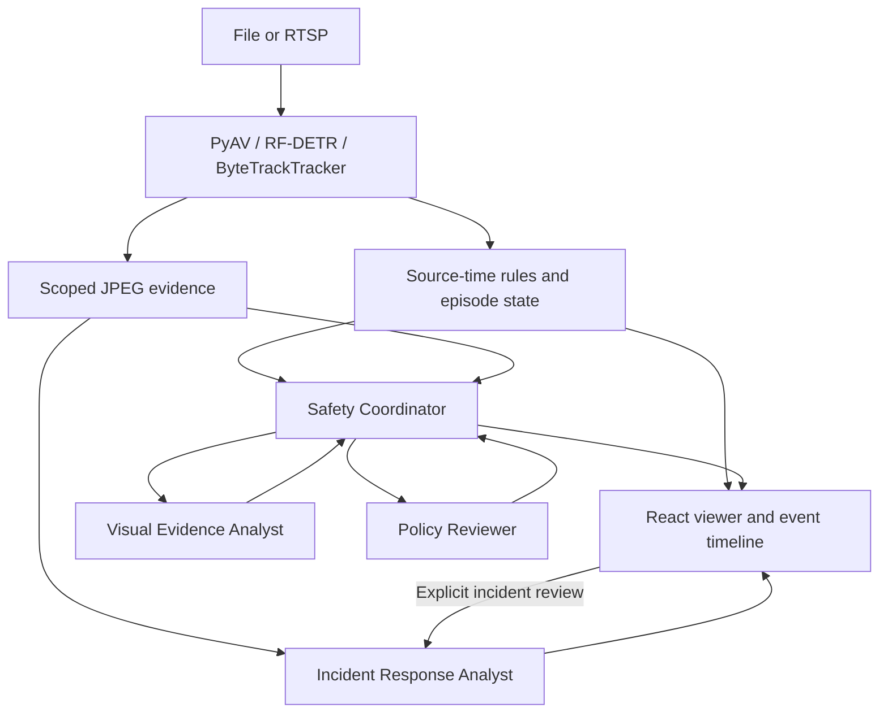

> The scheduled multimodal scene path is documented in [scene-review-report.md](scene-review-report.md). The legacy candidate/retrospective tool matrix below remains available; delegation is now disabled by default. AI modes run CV asynchronously and no longer gate scene review on rule candidates.

# Architecture

One local active source. FastAPI and asyncio coordinate decode/inference workers, deterministic rules, bounded JPEG storage, and bounded agent queues. SQLite retains appendable assessments, feedback, configuration and provenance. Source PTS drive rules; monotonic time measures processing/deadlines. Track IDs have meaning only within camera/session/generation. Measurements use normalized image-plane coordinates.

| Agent | Read-only tools | Typed output |
|---|---|---|
| Safety Coordinator | candidate, evidence summary, frames, tracks, zones, prior assessments; visual/policy delegation | RiskAssessment |
| Visual Evidence Analyst | frames, scoped crops, tracks, deterministic image geometry | VisualReview |
| Policy Reviewer | versioned local rule, local procedure search/section, evidence summary | PolicyReview |
| Incident Response Analyst | incident window, frames, tracks, event history, procedure section, deterministic intervals; visual delegation | ResponseReport |

All are fixed named Pydantic AI agents with typed dependencies. Specialists cannot delegate. Tools resolve IDs, never supplied filesystem paths. EvidenceScope is frozen and bounds every live frame/track retrieval by session/generation and as-of timestamp, even when a replay file contains later footage. Outputs are checked for matching context/cutoff, retrieved IDs and unchanged reference metadata. New assessments append rather than overwrite old cutoffs. Configuration and bounded procedures are snapshotted for provenance. Concise explanations/tool calls are persisted; hidden reasoning is not.

The scheduler has one serial live worker and a four-item queue, plus a separate serial two-item retrospective queue. Each live tree has two delegations, eight model requests including retries, 16,000 reported tokens, 32 transmitted images including repeated requests, and a 20-second deadline. Children share RunUsage and application-owned counters, with final synthesis capacity reserved. Output capacity is bounded on each request. Provider usage is only known after a response, so a single response can cross a reported token threshold; subsequent requests are blocked. Token ceilings are guardrails, not an exact monetary spending guarantee. No provider retries/escalation are initiated by application code. Pydantic output validation allows one retry within shared limits. Stale automatic queue packets are skipped. CV and initial candidate publication never wait on a model.

Lifecycle and AI/human state are independent. Dwell candidates start active, become clearing on visible zone exit, and close after clear persistence. Lost tracks preserve uncertainty. Crossing events are closed discrete occurrences with cooldown. AI states cover disabled/queued/running/reviewed/timeout/error/skipped; human feedback is a separate append-only record. Playback generation changes cancel work and reject late output. Optional sampled scene candidates are separate episodes and carry no detector hazard claim.

JPEG+FramePacket travel together over a two-envelope WebSocket buffer. React commits the decoded image and exact matching metadata together, places normalized SVG overlays at the image aspect ratio, and rejects stale session/generation frames. Camera-to-screen latency is unknown without synchronized capture timestamps; frame age is labeled as a processing proxy.

Initial limits are conservative configuration choices, not accuracy or latency promises. Evidence retention is bounded by rolling time, sampled pre-event coverage and post-event pins plus a 256 MiB global disk cap. Deletion under that cap may make historic evidence unavailable; metadata/records remain inspectable. No face recognition, cross-camera identity, physical TTC/calibration, automatic response, remote arbitrary tools, or network deployment is implemented.
